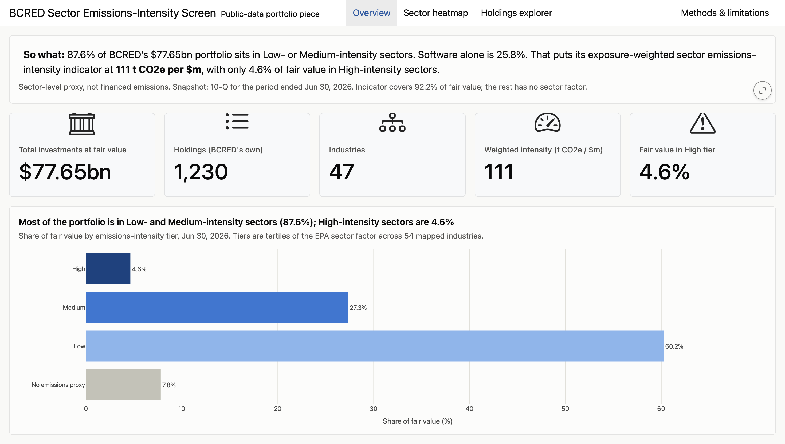

# BCRED Sector Emissions-Intensity Screen

A static, reproducible dashboard that screens the publicly reported holdings of
**Blackstone Private Credit Fund (BCRED, SEC CIK 1803498)** for **sector-level
emissions intensity**. It is built entirely in R and Quarto from free public
data, and published with GitHub Pages from the `/docs` folder.

**Live dashboard:** https://geobarz.github.io/bxci-sustainability-screener/ *(once GitHub Pages is enabled)*

<!-- SCREENSHOT PLACEHOLDER: save a screenshot of the Overview page as
     docs-notes/img/dashboard-overview.png and uncomment the line below. -->
<!--  -->
> 📷 *Screenshot coming soon.*

## The business question

**How exposed is BCRED's portfolio to emissions-intensive sectors, how concentrated
is that exposure, and how has it changed since 2022?**

The dashboard answers this with an **exposure-weighted sector emissions-intensity
indicator**: BCRED's fair value in each industry, weighted against EPA's average
supply-chain emissions per dollar for that industry. It also shows which sectors
drive the result, how much of the portfolio sits in High-, Medium- and Low-intensity
sectors, and a searchable view of BCRED's holdings.

> **Sector-level proxy, not financed emissions.** The indicator uses sector
> averages, not any company's reported emissions, and it is not a PCAF-style
> financed-emissions figure. See the dashboard's *Methods & limitations* page.

## Data sources (free and public)

| Source | Used for | Link |
|---|---|---|
| SEC BDC Data Sets | BCRED's schedule of investments and tagged financial data, 16 filings, Sep 2022 to Jun 2026 | [sec.gov/data-research/bdc-data-sets](https://www.sec.gov/data-research/bdc-data-sets) |
| SEC EDGAR submissions API | BCRED's list of 10-K and 10-Q filings | [EDGAR APIs](https://www.sec.gov/search-filings/edgar-application-programming-interfaces) |
| EPA Supply Chain GHG Emission Factors v1.3 | kg CO2e per 2022 USD by 6-digit NAICS industry | [data.gov record](https://catalog.data.gov/dataset/supply-chain-greenhouse-gas-emission-factors-v1-3-by-naics-6) |
| Supply Chain GHG Emission Factors v1.4.0 | Downloaded for comparison only (not an EPA release) | [Zenodo](https://doi.org/10.5281/zenodo.17202747) |

Exact file URLs, download dates and checksums are in `data/raw/bdc/manifest.csv`
and `data/raw/epa/manifest.csv`. Every assumption is logged, with its reason, in
[`docs-notes/DECISIONS.md`](docs-notes/DECISIONS.md).

## How to rerun it

### One-time setup

1. Install R (4.3+), RStudio (which includes Quarto), and these R packages:
   ```r
   install.packages(c("httr2", "jsonlite", "fs", "readr", "dplyr", "tidyr", "readxl",
                      "plotly", "reactable", "crosstalk", "htmltools"))
   ```
2. The SEC asks automated clients to identify themselves. Add this line to your
   `.Renviron` file (in RStudio: `usethis::edit_r_environ()`), then restart R:
   ```
   SEC_USER_AGENT="Your Name your.email@example.com"
   ```
   `.Renviron` is git-ignored, so your details are never committed.

### Run everything

From the project root:

```bash
Rscript run_all.R                  # runs steps 01-05, the metrics tests, and 06 (about 3 minutes)
cd dashboard && quarto render      # builds the site into docs/
cd .. && Rscript tests/test_dashboard.R   # checks the rendered numbers against the CSVs
```

### What each script does, in order

| Step | Script | Output |
|---|---|---|
| 01 | `R/01_fetch_sec.R`: download BCRED's filing list and the SEC BDC Data Set ZIPs (about 480 MB, not committed) | `data/raw/bdc/`, `data/raw/edgar/` |
| 02 | `R/02_clean_soi.R`: one row per holding for the latest period, reconciled to the filing's total | `data/processed/bcred_holdings_clean.csv` |
| 03 | `R/03_clean_sector_subtotals.R`: fair value by industry for all 16 filings, reconciled to each filing's total | `bcred_sector_exposure.csv`, `bcred_reconciliation.csv` |
| 04 | `R/04_fetch_epa_factors.R`: download the EPA factors | `data/raw/epa/` |
| 05 | `R/05_metrics.R`: apply the reviewed crosswalk (`data/reference/sector_naics_crosswalk.csv`) and calculate the metrics | `sector_summary.csv`, `portfolio_metrics.csv`, `industry_factors.csv` |
| tests | `tests/test_metrics.R`: sums to 100%, nothing dropped, ties to filings | prints PASS/FAIL |
| 06 | `R/06_dashboard_inputs.R`: copy source dates and the crosswalk into `data/processed/` for the Methods page | `data_sources.csv`, `crosswalk_for_methods.csv` |
| render | `dashboard/index.qmd`, `dashboard/methods.qmd`, which read only from `data/processed/` | `docs/` (with `.nojekyll`) |
| tests | `tests/test_dashboard.R`: rendered page vs CSVs | prints PASS/FAIL |

Optional: `R/02a_inspect_bcred_soi.R` prints the raw SOI columns and sample rows without writing anything.

## Folder map

| Folder | Purpose |
|---|---|
| `R/` | Numbered scripts; `R/00_helpers.R` holds shared functions |
| `data/raw/` | Raw downloads, date-stamped. SEC ZIPs are git-ignored; manifests are kept |
| `data/reference/` | The hand-built, user-reviewed industry-to-NAICS crosswalk |
| `data/processed/` | Cleaned data. The dashboard reads only from here |
| `dashboard/` | Quarto dashboard source |
| `docs/` | Rendered site served by GitHub Pages (do not hand-edit) |
| `tests/` | Checks for the metrics and the rendered dashboard |
| `docs-notes/DECISIONS.md` | Log of every assumption and why |

## Disclaimer

This is a **personal portfolio project** built only from **public data**. It is
**not affiliated with, endorsed by, or produced for Blackstone** or any of its funds,
and it uses no Blackstone private or non-public information. Nothing here is
investment advice. Figures come from public SEC filings and EPA data as downloaded
on the dates recorded in the manifests, and they may contain errors. The SEC notes
that its data sets are not a substitute for the filings themselves.
